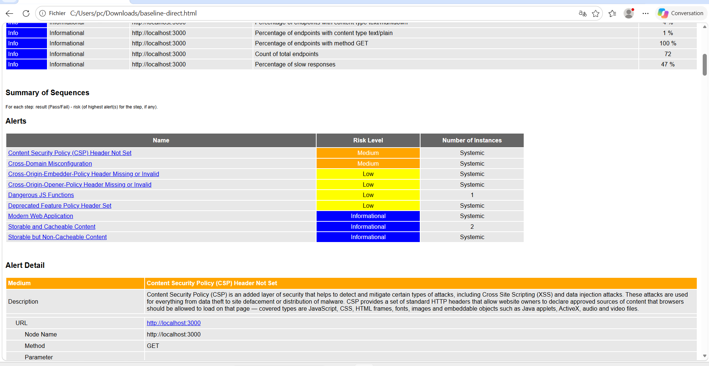
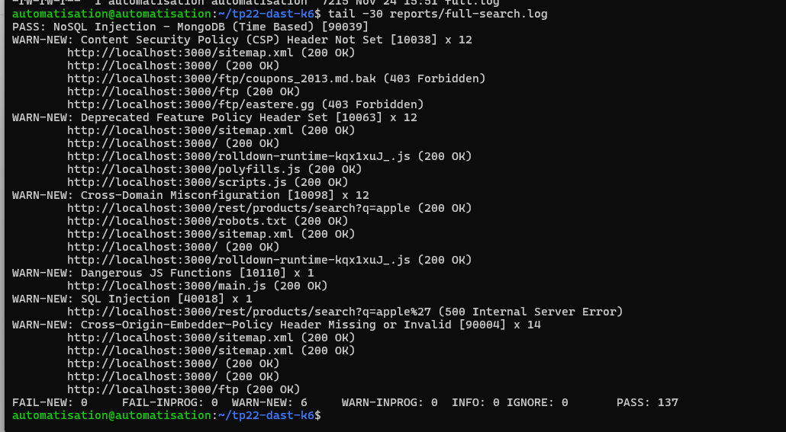
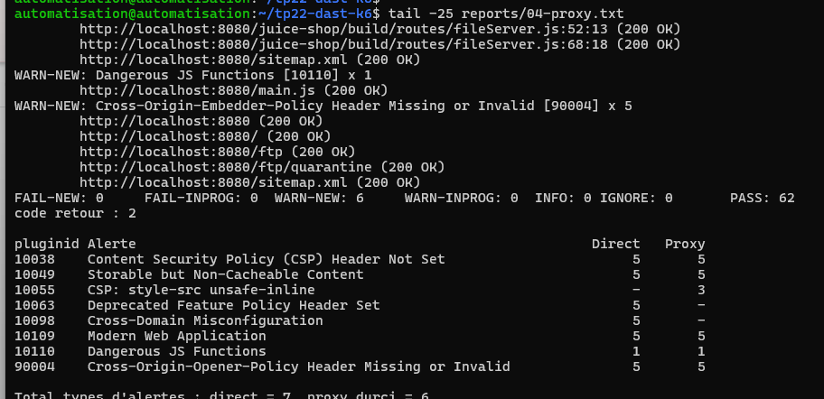
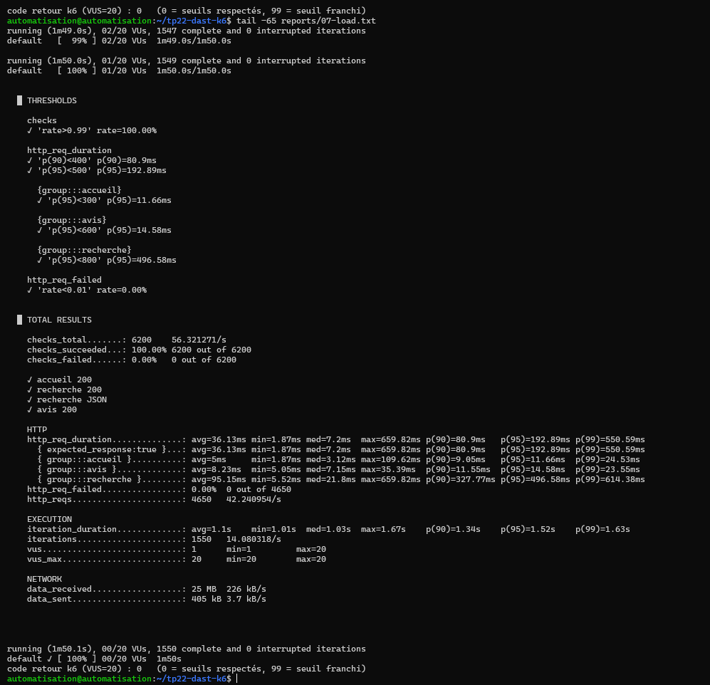
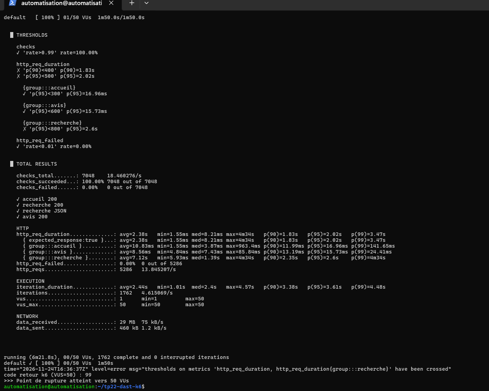

# TP22 : Tests dynamiques de sécurité (OWASP ZAP) et tests de charge (k6)

> ⚠️ **OWASP Juice Shop** est volontairement vulnérable. Ne scanne **jamais** une application qui ne t'appartient pas :
> un scan actif est une attaque.

```
tp22-dast-k6/
├── docker-compose.yml          Juice Shop (3000) + proxy Nginx durci (8080) + contact-api (3002)
├── nginx/default.conf          proxy durci : server_tokens off, en-têtes de sécurité, X-Powered-By masqué, CSP Report-Only
├── zap/rules.tsv               règles bloquantes ZAP (FAIL / WARN / IGNORE justifiés)
├── k6/smoke.js                 test de fumée (1 VU, 30 s)
├── k6/load.js                  montée / plateau / descente, groupes, seuils par groupe, abortOnFail
├── openapi.yaml                définition OpenAPI de contact-api (GET /api/health, POST /api/contact)
├── contact-api/                contact-api du TP8 (Express + Zod), cible du scan d'API
├── .github/workflows/dast-perf.yml   pipeline CI : ZAP baseline + k6 smoke + k6 load, bloquants
├── scripts/                    une commande par partie du TP
├── reponses.md                 réponses aux questions et tableaux à compléter
├── reports/                    rapports ZAP générés
└── captures/                   captures d'écran
```

---

## 0. Préparer la VM

Tu peux utiliser la même VM que pour le TP21 (`192.168.190.141`).

**1. Copier le zip** depuis PowerShell sur ton PC :
```powershell
scp $HOME\Downloads\tp22-dast-k6.zip automatisation@192.168.190.141:~/
```

**2. Dans la VM :**
```bash
cd ~ && unzip tp22-dast-k6.zip && cd tp22-dast-k6
chmod +x scripts/*.sh scripts/*.py
docker compose version        # si "unknown command" : sudo apt install -y docker-compose-v2
```

**3. Libérer le port 3000 et de la RAM** (le TP demande au moins 4 Go libres) :
- Arrête les port-forwards du TP21 (Ctrl + C dans leur terminal) : Grafana utilisait le port 3000.
- Si la VM manque de mémoire (`free -h`), arrête la pile du TP21 une fois ce TP rendu :
  `helm -n monitoring uninstall tempo alloy loki` (garde `kps` si tu veux faire le défi Prometheus).

## 1. Démarrer la cible
```bash
./scripts/00-up.sh
```
Tu dois voir les en-têtes du **direct (3000)**, puis ceux du **proxy (8080)** avec `X-Content-Type-Options`, `X-Frame-Options` et `Content-Security-Policy…`, et enfin `{"status":"ok"}` pour contact-api.

## 2. Les parties du TP

| Partie | Commande | Durée | Résultat |
|---|---|---|---|
| 1 : baseline direct | `./scripts/01-baseline-direct.sh` | ~2 min | `reports/baseline-direct.html` |
| 2 : full scan (actif) | `./scripts/02-full-scan.sh` | 15 à 30 min | `reports/full.html` |
| 2 : scan d'API | `./scripts/03-api-scan.sh` | ~5 min | `reports/api.html` |
| 3 : baseline via proxy durci | `./scripts/04-baseline-proxy.sh` | ~2 min | `reports/baseline-proxy.html` + tableau direct / proxy |
| 4 : liste des règles | `./scripts/05b-gen-conf.sh` | ~2 min | `reports/gen.conf` |
| 4 : règles bloquantes | `./scripts/05-rules.sh` | ~4 min | codes retour : **1** direct, **0** proxy |
| 5 : k6 smoke | `./scripts/06-k6-smoke.sh` | 30 s | résumé k6 |
| 5 : k6 load | `./scripts/07-k6-load.sh 20` | ~2 min | résumé avec seuils ✓ / ✗ |
| 5 : point de rupture | `./scripts/08-breaking-point.sh` + `docker stats` dans un 2e terminal | ~8 min | seuil franchi, code 99 |
| 6 : CI | push sur GitHub (voir plus bas) | ~10 min | workflow rouge, puis vert |

**Ouvrir les rapports HTML sur ton PC.** Depuis PowerShell :
```powershell
scp automatisation@192.168.190.141:~/tp22-dast-k6/reports/*.html $HOME\Downloads\
```
Puis double-clique sur le fichier `.html`.

Si `05-rules.sh` donne **1 sur le proxy** au lieu de 0, regarde quelle règle est en FAIL : le script l'affiche. Envoie-la-moi pour que j'ajuste `rules.tsv` ou `default.conf`.

---

## 3. Les 7 captures (dans `captures/`)

| Fichier | Comment l'obtenir |
|---|---|
| `zap-baseline.png` | ouvre `reports/baseline-direct.html` et capture le tableau **Summary of Alerts** et la liste des alertes |
| `zap-full.png` | ouvre `reports/full.html` et capture les alertes **High / Medium** absentes du baseline (SQL Injection, XSS…) |
| `zap-before-after.png` | capture le terminal après `./scripts/04-baseline-proxy.sh` : le tableau **Direct / Proxy** et le total d'alertes |
| `zap-rules-exit.png` | capture le terminal après `./scripts/05-rules.sh` : **code retour direct 1**, **proxy 0** |
| `k6-summary.png` | capture le terminal après `./scripts/07-k6-load.sh 20` : les seuils avec ✓ et les p(90) / p(95) |
| `k6-breaking-point.png` | capture le terminal après `./scripts/08-breaking-point.sh` : un seuil en **✗** et le code 99. Ajoute si possible le terminal `docker stats` |
| `ci-dast-perf.png` | onglet **Actions** de GitHub : le workflow **rouge** (PR qui retire un en-tête), puis **vert** |

### Obtenir `ci-dast-perf.png`

1. Publie le projet sur GitHub (dépôt `tp22-dast-k6`, même méthode que pour le TP21). Le workflow se lance tout seul (onglet **Actions**) et doit être **vert**.
2. Crée une branche qui retire un en-tête de sécurité :
   ```powershell
   git checkout -b test-retrait-entete
   ```
   Dans `nginx/default.conf`, supprime la ligne `add_header X-Content-Type-Options "nosniff" always;`, puis :
   ```powershell
   git commit -am "test : retrait de X-Content-Type-Options"
   git push -u origin test-retrait-entete
   ```
3. Sur GitHub, clique sur **Compare & pull request**, puis **Create pull request**. Le job `dast-perf` passe au **rouge** (règle 10021 en FAIL).
4. Capture la PR en échec et le run vert de `main` dans l'onglet Actions, puis ferme la PR sans la fusionner.

---

## 4. Défi (facultatif)

- **Scan authentifié** : récupère un token JWT (connexion à Juice Shop), puis ajoute-le à toutes les requêtes ZAP :
  ```bash
  TOKEN=$(curl -s -X POST http://localhost:3000/rest/user/login -H 'Content-Type: application/json' \
    -d '{"email":"admin@juice-sh.op","password":"admin123"}' | python3 -c 'import sys,json;print(json.load(sys.stdin)["authentication"]["token"])')
  docker run --rm --network host -v "$PWD:/zap/wrk:rw" ghcr.io/zaproxy/zaproxy:stable zap-baseline.py \
    -t http://localhost:3000 -r reports/baseline-auth.html -z "-config replacer.full_list(0).description=auth \
    -config replacer.full_list(0).enabled=true -config replacer.full_list(0).matchtype=REQ_HEADER \
    -config replacer.full_list(0).matchstr=Authorization -config replacer.full_list(0).regex=false \
    -config replacer.full_list(0).replacement=Bearer\ $TOKEN"
  ```
  Compare ensuite le nombre d'URL et d'alertes avec `baseline-direct.html`.
- **k6 → Prometheus du TP21** : active le récepteur remote-write (`prometheus.prometheusSpec.enableRemoteWriteReceiver: true` dans les values de kps), puis :
  ```bash
  docker run --rm -i --network host -e BASE_URL=http://localhost:8080 \
    -e K6_PROMETHEUS_RW_SERVER_URL=http://localhost:9090/api/v1/write \
    grafana/k6 run -o experimental-prometheus-rw - < k6/load.js
  ```
  Le port-forward Prometheus (9090) doit être actif. Dans Grafana, les métriques `k6_*` sont alors disponibles.

## 5. Nettoyage
```bash
./scripts/down.sh
```

---

## 6. Captures d'écran

### Rapport ZAP baseline (scan passif direct)


### Alertes supplémentaires du scan actif (full scan)


### Alertes direct / via proxy durci


### Codes retour avec rules.tsv : 1 (direct) puis 0 (proxy durci)


### Résumé k6 avec les seuils


### Point de rupture : seuil franchi


### Workflow CI dast-perf : en échec puis réussi

